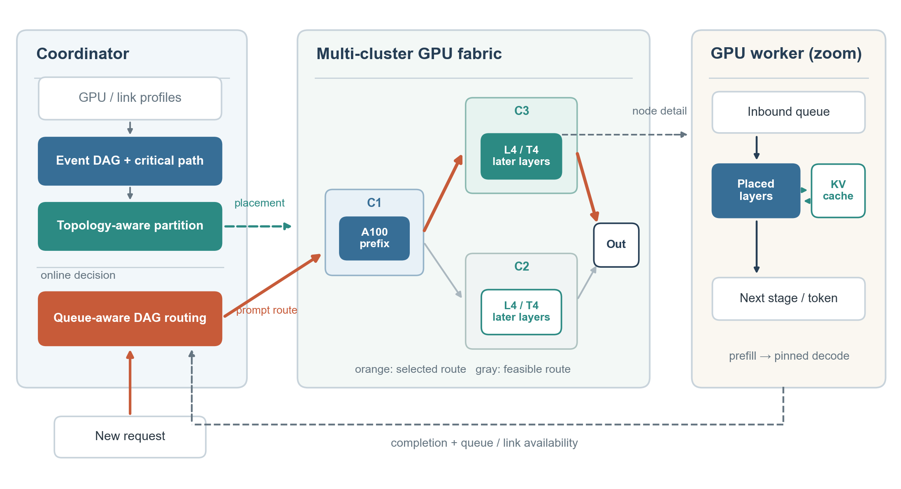

# Helix-GREEN：整体方法框架

> 本文档描述**当前已经实现并完成仿真验证的版本**。方法面向异构 GPU、可能跨集群的 LLaMA-70B 流水线推理；系统目标是提高输出吞吐、降低请求延迟。能耗与碳排放不在当前优化目标或实验指标中。

论文插图可用[矢量 PDF](paper_figures/ccf_integrated_framework.pdf)或[可编辑 SVG](paper_figures/ccf_integrated_framework.svg)。图展示逻辑控制流和执行流；C1/C2/C3 中的设备与层段为示意，精确放置见[单集群图](paper_figures/fig04_single_placement.pdf)和[三集群图](paper_figures/fig05_multi_placement.pdf)。

## 1. 核心问题与系统思路

一个请求的实际执行时间取决于模型层放在哪些 GPU、相邻阶段经过哪些链路、以及到达时这些资源正在处理多少工作。只按 GPU 算力均分模型层，可能增加跨集群传输；只按静态链路容量选路，又可能把新请求送入已排队的 GPU。放置与路由因此需要建立在同一套计算、通信、排队抽象上。

本方案把问题分成**相互衔接的三个决策**：离线建立包含资源依赖的事件 DAG，识别关键资源；利用关键路径反馈和物理拓扑，形成容量可行的模型放置；在每个提示请求到达时读取当前队列状态，在该放置产生的分层 DAG 上选择执行路径。已有请求的解码沿提示阶段选定的路径继续运行，以保留 KV 缓存位置。同链路上已经就绪的解码请求可即时合并传输。

| 阶段 | 面对的困难 | 输入 → 输出 | 方法 |
| --- | --- | --- | --- |
| 挑战一：建模 | GPU、传输、排队共同决定瓶颈 | GPU/链路画像与代表性并发请求 → 关键路径、瓶颈资源和需求排序 | 资源依赖事件 DAG；路径集合需求的前后向动态规划 |
| 挑战二：放置 | 层边界与设备位置、链路代价相互影响 | 模型输出、物理拓扑与显存容量 → 设备层区间及合法执行 DAG | 拓扑收缩、容量约束粗划分、关键资源邻域细化 |
| 挑战三：调度 | 静态最快路径会因队列和 KV 会话变化而失效 | 已部署放置、请求、当前资源快照 → 提示执行路径；后续固定解码路径 | 队列感知分层 DAG 最短路；就绪解码传输合并 |

## 2. 问题抽象与目标

物理图 $G_P=(V,E)$ 中，GPU $v\in V$ 具有类型、显存容量和分层计算画像；链路 $e\in E$ 具有带宽与传播时延。模型是按顺序执行的 $L=80$ 层链。放置为每个启用的 GPU 指定连续层区间 $[a_v,b_v)$，要求区间长度不超过该设备的可承载层数。当前实现构造一个**共享前缀加两条完整后缀路径**；每条后缀都能与前缀共同覆盖全部层，两个后缀使用的设备不重复。导出的层兼容图还允许请求在满足层连续性与物理链路条件时组合合法阶段。

系统级目标有两维：**尽量提高固定窗口内完成的输出 token 吞吐**，同时**降低请求延迟**；延迟以 P95 TTFT 和 P95 TPOT 分别报告。当前实现不声称求得该多指标问题的全局最优。离线放置使用归一化代理分数比较局部移动，在线调度使用以秒计的当前工作量代价，最终优劣由同轨迹仿真测量判定。

## 3. 离线阶段：事件 DAG 建模

### 3.1 计算、通信与资源依赖

把一次提示或解码执行拆成 GPU 计算、链路带宽占用、传播时延和显式等待事件。**请求依赖边**保证模型层与 token 的先后顺序；**资源依赖边**把共享 GPU 或链路上的操作串行化。对事件 $e$，完成时间按 max-plus 递推：

\[
F(e)=d(e)+\max_{p\in\operatorname{pred}(e)}F(p),
\]

其中 $d(e)$ 是事件持续时间。由终点回溯最长路，可以指出延长完成时间的 GPU 或链路，而不是只给出一个不可解释的总延迟。当前放置代理使用**固定的四个交错请求、每个八个输出 token**作为代表性并发工作负载；它不读取待测实验的未来到达序列。[`event_graph.py`](critical_graph/event_graph.py) 实现事件图及关键路径，[`topology.py`](critical_graph/topology.py) 把 GPU/网络画像转换为阶段代价。

### 3.2 路径集合需求

导出的层兼容 DAG 可以形成比两条设计后缀更多的合法“拼接路径”。仅分析一条代表路径，可能低估几条路径汇入同一 GPU 的负载。单集群最终放置因此使用[前后向 log-sum-exp 动态规划](critical_graph/path_ensemble.py)计算边的软路径权重和 GPU/链路的边际需求；不显式枚举所有完整请求路线。这些权重是**离线解释与放置代理**，不是线上真实选路概率，也不是未来流量预测。

三集群最终放置采用代表性关键路径需求：物理拓扑存在明显的跨集群时延间隙，放置更强调阶段顺序与跨区域传输。当前“单集群用路径集合、三集群用典型关键路径”的规则由拓扑分组触发；这项配置是在开发实验后确定的，需要独立种子继续检验泛化性。

## 4. 离线阶段：关键路径反馈的模型放置

放置算法先根据链路时延中最大的相邻比例间隙划分“快连接”设备组，再构造显存容量可行的共享前缀和两条后缀。后缀内的 GPU 顺序同时考虑传播时延与激活传输时间。然后仅在**当前关键路径或最大需求资源的邻域**提出局部变更：相邻阶段之间移动一层边界、交换相邻 GPU 顺序，或调整共享前缀边界。每次选择代理分数下降最大的合法变更，直到没有正收益或达到步数上限。[`partition.py`](critical_graph/partition.py) 保存最终层区间、仿真布局和搜索轨迹。

代理分数是相对粗放置的三个量的加权和：

\[
J(P)=0.40\frac{\widehat{T}_{\mathrm{TTFT}}(P)}{\widehat{T}_{\mathrm{TTFT}}(P_0)}
    +0.35\frac{\widehat{T}_{\mathrm{TPOT}}(P)}{\widehat{T}_{\mathrm{TPOT}}(P_0)}
    +0.25\frac{\widehat{B}(P)}{\widehat{B}(P_0)}.
\]

$P_0$ 是容量可行的粗放置，$\widehat{B}$ 是最大资源需求代理。权重只用于**离线局部搜索**；不能把 $J$ 解释成真实 P95、吞吐或最优性证明。它使计算延迟、传输及瓶颈服务需求共同影响层边界，而显存与完整层覆盖始终是硬约束。最终文件为[单集群放置](critical_graph/runs/single_final/placement.json)和[三集群放置](critical_graph/runs/multi_final/placement.json)。

## 5. 在线阶段：队列感知的分层 DAG 调度

### 5.1 到达时读取状态，沿层边界搜索

提示请求到达时，调度器读取**正在执行的批、GPU/链路队列及活跃 KV 会话**，为 GPU 和链路计算当前未完成工作的释放时间。状态 $(\ell,v)$ 表示已执行到层边界 $\ell$、上一阶段位于 $v$。若下一 GPU $u$ 持有从 $\ell$ 开始的一段层并且存在 $v\rightarrow u$ 链路，才加入一条使层边界严格前进的边；因此搜索图无环。

最终调度版本在该 DAG 上用**加性、以秒为单位的工作量代价**做动态规划。一次转移包括当前链路等待与传输、本 GPU 当前工作等待与本请求提示计算，以及该 GPU 上活跃 KV 会话的一轮解码服务需求：

\[
c(v,u)=W_{\mathrm{link}}(v,u)+T_{\mathrm{transfer}}(v,u)
       +W_{\mathrm{GPU}}(u)+T_{\mathrm{prompt}}(u)
       +N_{\mathrm{KV}}(u)T_{\mathrm{decode1}}(u).
\]

在这里，$W$ 来自**到达时的资源快照**，不是对未来请求数或输出长度的预测。选择从源点到第 $L$ 层汇点代价最小的合法路径；由于状态按层边界前进，动态规划无需枚举全部路线。提示阶段将路径登记到会话，后续 decode token 复用该路径以避免 KV 迁移。最终版本对仿真器 batch=1 decode 服务时间的倍时规则做了对应修正；实现入口为[`QueueAwareDagScheduler`](queue_dag/scheduler_final.py)，基础搜索和资源快照见[`scheduler_queue_cost.py`](queue_dag/scheduler_queue_cost.py)与[`routing_dag.py`](queue_dag/routing_dag.py)。

### 5.2 已就绪 decode 的即时传输合并

当一个链路可发送时，调度器把**此刻已经就绪、下一跳相同**的 decode 请求放进同一传输对象；提示请求保持单独传输。不等待未来请求凑批，也不更改模型层顺序或既有 KV 路径。仿真器在这一传输对象上共享一次链路传播时延，因此该收益取决于其传输语义；真实网络实现还需单独验证。

## 6. 总图中的一轮运行流程

1. **部署前**读取 GPU 计算画像、显存容量和物理链路参数，建立事件 DAG，得到关键资源与需求代理。
2. **部署前**以关键资源为反馈构造并细化容量可行的放置，输出每台 GPU 的连续模型层、链路连接和可搜索的层兼容 DAG。
3. **请求到达**时，控制器读取当前队列/链路状态，在层兼容 DAG 上为提示阶段选定路径。
4. **执行时**请求依次经过选定 GPU 的接收队列与模型层；设备保留该会话的 KV 缓存，后续解码继续沿原路径。已就绪且同下一跳的 decode 可以合并传输。
5. **完成与反馈**更新队列和链路可用状态，供下一次提示请求准入时重新决策。总图中的状态回传表示仿真器中的状态读取与完成事件，不声称已部署独立的跨机器遥测控制平面。

这条链路解释了三个挑战的关系：**建模决定应该关注哪些资源，放置决定有哪些合法而高效的路径，调度根据运行时状态从这些路径中作选择。**

## 7. 论文可主张的贡献与证据边界

当前最稳妥的主张是：在相同 Helix 仿真环境与请求轨迹下，资源依赖建模能够更好解释忙碌 GPU 的位置；拓扑约束放置与队列感知调度分别在受控对照中改善吞吐/延迟；整合方案在官方负载和统一协议负载扫描中改善端到端指标。[主结果报告](multiseed/RESULTS.md)与[补充实验报告](ccfa_validation/RESULTS.md)记录了协议、样本数、原始 JSON 和局限；[论文图册](paper_figures/FIGURE_GUIDE.md)提供总图、放置图、瓶颈图、归因图、主结果图和敏感性曲线。

| 证据 | 单集群 | 三集群 | 应如何表述 |
| --- | ---: | ---: | --- |
| 官方负载下输出吞吐：Helix → 整合方案 | 141.568 → 153.476 token/s | 59.324 → 70.406 token/s | 完整系统在两种拓扑、同轨迹单种子下的效果 |
| 官方负载下 P95 TTFT | 6.399 → 4.226 s | 15.867 → 7.177 s | 与吞吐并列报告，附完成率和窗口末积压 |
| 官方负载下 P95 TPOT | 1.666 → 0.779 s | 3.230 → 0.926 s | 同上 |
| 240 s 资源画像的 GPU 忙碌排序相关系数：典型路径 → 路径集合 | 0.753 → 0.859 | 0.678 → 0.808 | 支持模型的资源解释力，不等于 P95 预测准确率 |

**边界。** 所有结果来自仿真而非真实 GPU；官方负载和开发负载的主比较均已有种子 0/1/2 的成对结果，但种子 1 曾参与开发调参。放置和调度归因是两个**不同的控制变量实验**，其百分比不能相加当作端到端收益。最终 1800 秒结果尚无逐时队列或完整请求级延迟样本，因此不能在论文里凭汇总 JSON 画时间曲线或延迟 CDF。当前也没有能耗与碳排测量。

## 8. 直接用于论文“系统概述”的短段落

> 图 1 展示系统的整体流程。部署前，控制器根据异构 GPU 和网络画像构建资源依赖事件 DAG，通过关键路径及路径需求识别潜在瓶颈；随后在显存容量与层覆盖约束下联合确定层边界和 GPU 位置，形成可供执行的分层 DAG。请求到达时，控制器读取 GPU、链路及活跃 KV 会话的当前工作状态，以队列感知代价在该 DAG 上选择提示执行路径。GPU 工作节点按路径顺序处理模型层，并在后续解码中复用原路径；同链路上已就绪的解码请求可即时合并传输。完成事件和资源状态为后续请求提供新的调度依据。系统将解释性瓶颈建模、拓扑感知放置与动态请求调度连接为一套流水线推理方法。

这段是**方法概述**，正文后续仍需分别解释代理目标、局部变更规则、在线转移代价及固定窗口实验协议；不应把总图中的示意性集群层段当作实际生成的层区间。
