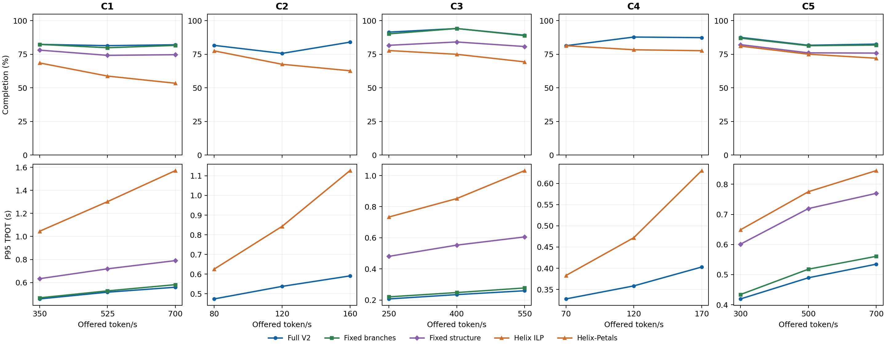

# RCAPS V2 资源池内低、中、高负载扫描

## 协议

在 C1–C5 各资源池内固定已生成的放置，选三档共同提供负载。每档所有可行方法使用同一请求轨迹，种子 100、600 秒、零预热，窗口结束不排空；[`sensitivity_summary.json`](sensitivity_summary.json)逐项核对了负载、时长、轨迹哈希并保存吞吐、P95 TTFT、P95 TPOT、完成率和窗口末积压。**这是单种子的开发扫描，不能替代 1800 秒、三种子的[正式主表](RESULTS_CN.md)。**短窗口的完成率也受请求在窗口尾被截断影响；结合积压和尾延迟看，不能只凭完成率判断系统是否饱和。

[可放大 SVG](resource_load_sweep.svg)。C1/C2 的橙线为 Helix ILP；C3–C5 为重新生成 Petals 放置的 Helix MaxFlow，图例中分别标识。C2/C4 的旧 Fixed Structure 因容量不足不可行；这两池 Full V2 与 Fixed Branches 是同一布局，只运行一次在线窗口，图中不另绘固定两后缀曲线。

## 同池负载变化

下表的 `V2 / H` 分别表示 Full V2 和该池可运行的 Helix 部署。吞吐单位为完成输出 token/s，TPOT 为秒，完成率为百分比。C1/C2 的 H 是 ILP，C3–C5 的 H 是 Helix–Petals；**不能把两种 H 视为同一放置算法**。

| 池 | 提供 token/s | 吞吐 V2 / H | P95 TPOT V2 / H | 完成率 V2 / H | 末端积压 V2 / H |
| --- | ---: | ---: | ---: | ---: | ---: |
| C1 | 350 | 73.265 / 62.152 | 0.458 / 1.045 | 82.4 / 68.6 | 37 / 66 |
| C1 | 525 | 105.868 / 83.965 | 0.516 / 1.302 | 81.4 / 58.8 | 59 / 131 |
| C1 | 700 | 137.817 / 103.377 | 0.559 / 1.572 | 82.1 / 53.5 | 75 / 195 |
| C2 | 80 | 17.043 / 16.323 | 0.474 / 0.625 | 81.6 / 77.6 | 9 / 11 |
| C2 | 120 | 25.357 / 23.020 | 0.538 / 0.843 | 75.7 / 67.6 | 18 / 24 |
| C2 | 160 | 29.850 / 26.153 | 0.591 / 1.127 | 84.0 / 62.8 | 15 / 35 |
| C3 | 250 | 58.813 / 52.057 | 0.207 / 0.733 | 91.5 / 77.8 | 13 / 34 |
| C3 | 400 | 92.108 / 79.900 | 0.235 / 0.852 | 94.2 / 75.0 | 14 / 60 |
| C3 | 550 | 125.078 / 101.107 | 0.259 / 1.032 | 89.2 / 69.4 | 36 / 102 |
| C4 | 70 | 15.573 / 15.237 | 0.328 / 0.383 | 81.4 / 81.4 | 8 / 8 |
| C4 | 120 | 27.072 / 26.197 | 0.358 / 0.472 | 87.8 / 78.4 | 9 / 16 |
| C4 | 170 | 37.662 / 35.652 | 0.403 / 0.630 | 87.4 / 77.7 | 13 / 23 |
| C5 | 300 | 65.825 / 62.768 | 0.419 / 0.649 | 87.6 / 81.1 | 23 / 35 |
| C5 | 500 | 102.110 / 94.892 | 0.490 / 0.775 | 81.7 / 75.1 | 55 / 75 |
| C5 | 700 | 138.205 / 126.713 | 0.535 / 0.845 | 82.6 / 72.1 | 73 / 117 |

在这 15 个开发窗口中，V2 对该池 Helix 部署的吞吐均较高、P95 TPOT 均较低；高负载时 Helix 的积压增长更快。**该趋势只针对上述各自重新部署后的方法与此单种子短窗口**。C2 的 120 token/s 档 P95 TTFT 为 V2 4.664 秒、Helix 4.642 秒，是反向的轻微差别，不能扩展成所有尾延迟指标均改善的表述。

Fixed Branches 在 C1/C3/C5 的 P95 TPOT 三档依次为 `0.467/0.528/0.582`、`0.220/0.248/0.277`、`0.434/0.518/0.561` 秒；同档 V2 分别是 `0.458/0.516/0.559`、`0.207/0.235/0.259`、`0.419/0.490/0.535` 秒。Fixed Structure 在这三池各档均更慢，完整原值见机器汇总。C2/C4 的固定两后缀与 V2 重合，故本扫描没有提供独立的放置增益证据。

各池内部的负载设置相同，允许在同一池同一档配对比较。不同池的硬件和提供负载不同，图中的吞吐绝对值不能横向当作相对性能。新负载没有重新优化放置，因此这里只检验既定部署在负载变化下的表现，不声称证明负载感知的放置适配。
