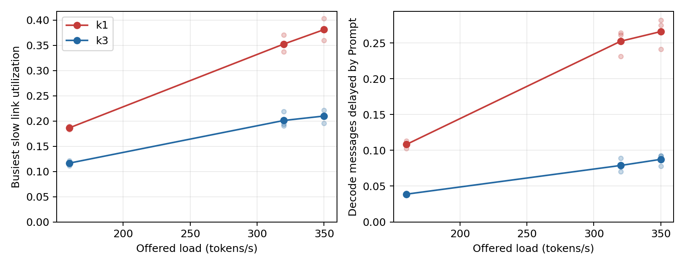
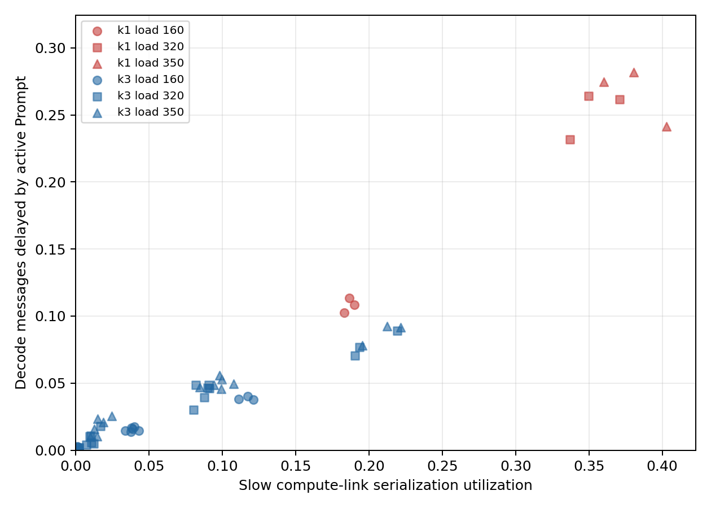

# V3 慢链路 Prefill/Decode 传输干扰验证

## 口径

固定窗口 600 秒，不排空；逐种子配对相同到达轨迹。链路利用率是窗口内发送占用带宽相对容量的积分，不含传播延迟。逐链路 Prompt 字节为窗口内开始发送的消息总量。尾部查询按每查询平均 TPOT 取最高 5%；被阻挡步骤只统计对 TPOT 有贡献的第二个及后续已完成 Decode 步骤。同链路与共享 NIC 的时间交集单独计算，合并占用取时间并集。

## 基线画像

| 结构 | 负载 | 种子 | 吞吐 tok/s | TPOT P95 s | 尾部同链路阻挡率 | 全体同链路阻挡率 | 慢链路尾部/全体阻挡率 | 尾部平均阻挡秒/步 | 全体平均阻挡秒/步 | 尾部查询/步数 | 查询级差值 95% CI |
| --- | ---: | ---: | ---: | ---: | ---: | ---: | ---: | ---: | ---: | ---: | --- |
| k1 | 160 | 1 | 27.762 | 0.908 | 0.139 | 0.109 | 0.139/0.109 | 0.165 | 0.105 | 5/274 | [0.028, 0.064] |
| k1 | 160 | 2 | 30.735 | 0.863 | 0.130 | 0.114 | 0.130/0.114 | 0.135 | 0.103 | 5/598 | [0.014, 0.027] |
| k1 | 160 | 3 | 29.863 | 0.861 | 0.126 | 0.103 | 0.126/0.103 | 0.130 | 0.095 | 5/562 | [0.025, 0.035] |
| k1 | 320 | 1 | 44.518 | 1.518 | 0.364 | 0.232 | 0.364/0.232 | 0.292 | 0.202 | 10/154 | [0.092, 0.162] |
| k1 | 320 | 2 | 47.420 | 1.988 | 0.471 | 0.265 | 0.471/0.265 | 0.633 | 0.235 | 10/85 | [0.191, 0.417] |
| k1 | 320 | 3 | 46.533 | 2.164 | 0.516 | 0.262 | 0.516/0.262 | 0.673 | 0.263 | 10/93 | [0.169, 0.281] |
| k1 | 350 | 1 | 50.417 | 1.523 | 0.367 | 0.275 | 0.367/0.275 | 0.295 | 0.214 | 11/703 | [0.088, 0.110] |
| k1 | 350 | 2 | 50.212 | 1.589 | 0.346 | 0.279 | 0.346/0.279 | 0.343 | 0.241 | 11/872 | [0.070, 0.119] |
| k1 | 350 | 3 | 53.260 | 1.430 | 0.257 | 0.238 | 0.257/0.238 | 0.238 | 0.203 | 11/840 | [0.019, 0.049] |
| k3 | 160 | 1 | 30.737 | 0.589 | 0.049 | 0.032 | 0.046/0.028 | 0.070 | 0.032 | 5/370 | [0.013, 0.032] |
| k3 | 160 | 2 | 34.513 | 0.566 | 0.047 | 0.031 | 0.045/0.028 | 0.057 | 0.027 | 5/575 | [0.011, 0.025] |
| k3 | 160 | 3 | 32.907 | 0.574 | 0.061 | 0.034 | 0.052/0.029 | 0.072 | 0.030 | 5/636 | [0.023, 0.046] |
| k3 | 320 | 1 | 55.122 | 0.679 | 0.096 | 0.065 | 0.088/0.058 | 0.112 | 0.059 | 10/1343 | [0.028, 0.043] |
| k3 | 320 | 2 | 60.542 | 0.705 | 0.114 | 0.065 | 0.099/0.059 | 0.128 | 0.058 | 10/466 | [0.046, 0.114] |
| k3 | 320 | 3 | 63.513 | 0.756 | 0.109 | 0.077 | 0.104/0.065 | 0.158 | 0.070 | 10/714 | [0.028, 0.056] |
| k3 | 350 | 1 | 62.035 | 0.680 | 0.109 | 0.072 | 0.098/0.064 | 0.113 | 0.059 | 11/1179 | [0.033, 0.063] |
| k3 | 350 | 2 | 66.038 | 0.708 | 0.136 | 0.076 | 0.121/0.070 | 0.132 | 0.064 | 11/996 | [0.050, 0.097] |
| k3 | 350 | 3 | 68.235 | 0.726 | 0.132 | 0.082 | 0.125/0.073 | 0.146 | 0.070 | 11/607 | [0.038, 0.086] |

查询级差值是尾部查询与其余查询的平均阻挡步骤比例之差，95% 区间由查询为聚类单位的 2000 次 bootstrap 得到；完整数值见 `tail_query_bootstrap.json`，其中也有仅限慢速计算节点间链路的查询级区间。逐链路 Prompt/Decode 字节、消息数、利用率和等待统计见 `slow_links.csv`；其中逐链路阻挡率以该链路**全部 Decode 消息**为分母，由原始事件重算。同链路、共享 NIC 和交叠时间的消息级分解见 `interference_components.csv`，交叠只在并集内计算一次，另有慢链路 Decode 等待与 Prompt 占用总时长。这些消息级时间不相加冒充 TPOT。每次运行的所有链路与路径统计见 `analysis.json`。不同结构可能选用不同路径，逐链路字节下降不能单独证明复制的纯因果作用。

### 慢链路 Decode 等待的 Prompt 重叠（负载 320）

| 结构 | 种子 | 慢链路 Decode 等待总秒数 | 与同链路 Prompt 重叠秒数 | 重叠占等待比例 |
| --- | ---: | ---: | ---: | ---: |
| k1 | 1 | 5410.1 | 5396.0 | 0.997 |
| k1 | 2 | 6687.0 | 6672.0 | 0.998 |
| k1 | 3 | 7341.6 | 7325.0 | 0.998 |
| k3 | 1 | 1935.5 | 1935.5 | 1.000 |
| k3 | 2 | 2104.6 | 2104.5 | 1.000 |
| k3 | 3 | 2676.6 | 2676.5 | 1.000 |

分母仅是已开始发送的 Decode 消息在慢速计算节点间链路上的就绪至开始等待，不包含 GPU 等待或请求尚未就绪的时间；该比例不能解释同等比例的查询 TPOT。

## 传输字节干预

| 结构 | 干预 | 种子 | ΔTPOT P95 s | ΔTTFT P95 s | Δ吞吐 tok/s | Δ完成率 | Δ积压 | 共同完成查询 | 配对 TPOT P95 原→干预 s |
| --- | --- | ---: | ---: | ---: | ---: | ---: | ---: | ---: | --- |
| k1 | decode_zero | 1 | -0.100 | -0.077 | 1.805 | 0.027 | -5 | 105 | 1.273→1.166 |
| k1 | decode_zero | 2 | -0.226 | -0.000 | 2.717 | 0.077 | -15 | 96 | 1.400→1.228 |
| k1 | decode_zero | 3 | -0.007 | -0.001 | 2.950 | 0.047 | -9 | 89 | 1.545→1.356 |
| k1 | ideal_bandwidth | 1 | -0.677 | -2.950 | 8.477 | 0.167 | -31 | 105 | 1.273→0.807 |
| k1 | ideal_bandwidth | 2 | -1.061 | -3.327 | 10.785 | 0.235 | -46 | 96 | 1.400→0.797 |
| k1 | ideal_bandwidth | 3 | -1.242 | -3.357 | 13.867 | 0.244 | -47 | 89 | 1.545→0.850 |
| k1 | prompt_zero | 1 | -0.577 | -2.949 | 7.098 | 0.140 | -26 | 105 | 1.273→0.846 |
| k1 | prompt_zero | 2 | -0.988 | -3.326 | 9.330 | 0.189 | -37 | 96 | 1.400→0.863 |
| k1 | prompt_zero | 3 | -1.121 | -3.355 | 11.432 | 0.187 | -36 | 89 | 1.545→0.975 |
| k3 | decode_zero | 1 | -0.006 | 0.685 | 0.092 | 0.005 | -1 | 145 | 0.683→0.662 |
| k3 | decode_zero | 2 | -0.020 | 0.223 | 0.425 | 0.005 | -1 | 149 | 0.675→0.664 |
| k3 | decode_zero | 3 | -0.026 | 0.386 | 0.337 | 0.005 | -1 | 147 | 0.743→0.698 |
| k3 | ideal_bandwidth | 1 | -0.065 | -1.766 | 1.355 | 0.016 | -3 | 145 | 0.683→0.613 |
| k3 | ideal_bandwidth | 2 | -0.077 | -1.938 | 1.778 | 0.026 | -5 | 149 | 0.675→0.611 |
| k3 | ideal_bandwidth | 3 | -0.115 | -2.416 | 1.758 | 0.026 | -5 | 147 | 0.743→0.629 |
| k3 | prompt_zero | 1 | -0.094 | -1.767 | 1.517 | 0.016 | -3 | 145 | 0.683→0.585 |
| k3 | prompt_zero | 2 | -0.111 | -2.018 | 2.073 | 0.031 | -6 | 149 | 0.675→0.590 |
| k3 | prompt_zero | 3 | -0.156 | -2.415 | 2.352 | 0.036 | -7 | 147 | 0.743→0.598 |

### 近似无限带宽下的 k1 与 k3 差距

| 种子 | 原 TPOT P95 差距 s | 理想带宽差距 s | 差距缩小比例 |
| ---: | ---: | ---: | ---: |
| 1 | 0.839 | 0.227 | 0.729 |
| 2 | 1.283 | 0.299 | 0.767 |
| 3 | 1.409 | 0.282 | 0.800 |

带宽极大化保留传播延迟，给出串行化通信的系统级反事实；差距缩小比例不是逐请求延迟的精确归因比例。

完整配对结果、完成率与积压变化见 `interventions.csv`。Prompt/Decode 置零仅作用于计算节点间的激活字节；token 字节、传播延迟、计算、KV 和输入轨迹不变。它改变后续请求时序，因此是系统级因果干预，而非精确的延迟分量扣除。

## 慢链路负担与路径

| 结构 | 负载 | 种子 | 活跃慢链路 | Prompt 总 MB | 最忙链路 Prompt MB | 最高发送占用率 | 每查询平均慢链路数 |
| --- | ---: | ---: | ---: | ---: | ---: | ---: | ---: |
| k1 | 160 | 1 | 1 | 1264.8 | 1264.8 | 0.190 | 1.000 |
| k1 | 160 | 2 | 1 | 1207.7 | 1207.7 | 0.186 | 1.000 |
| k1 | 160 | 3 | 1 | 1189.7 | 1189.7 | 0.183 | 1.000 |
| k1 | 320 | 1 | 1 | 2298.4 | 2298.4 | 0.337 | 1.000 |
| k1 | 320 | 2 | 1 | 2373.6 | 2373.6 | 0.350 | 1.000 |
| k1 | 320 | 3 | 1 | 2550.2 | 2550.2 | 0.371 | 1.000 |
| k1 | 350 | 1 | 1 | 2419.6 | 2419.6 | 0.360 | 1.000 |
| k1 | 350 | 2 | 1 | 2587.0 | 2587.0 | 0.380 | 1.000 |
| k1 | 350 | 3 | 1 | 2742.5 | 2742.5 | 0.403 | 1.000 |
| k3 | 160 | 1 | 6 | 1273.1 | 792.2 | 0.121 | 1.073 |
| k3 | 160 | 2 | 5 | 1218.6 | 698.4 | 0.111 | 1.063 |
| k3 | 160 | 3 | 5 | 1197.3 | 755.8 | 0.117 | 1.072 |
| k3 | 320 | 1 | 6 | 2381.0 | 1283.3 | 0.193 | 1.217 |
| k3 | 320 | 2 | 6 | 2478.2 | 1235.9 | 0.190 | 1.227 |
| k3 | 320 | 3 | 6 | 2701.2 | 1449.6 | 0.219 | 1.250 |
| k3 | 350 | 1 | 6 | 2535.8 | 1259.9 | 0.195 | 1.232 |
| k3 | 350 | 2 | 6 | 2758.5 | 1381.0 | 0.213 | 1.274 |
| k3 | 350 | 3 | 7 | 2974.7 | 1450.2 | 0.222 | 1.319 |

总字节和最忙链路字节应分别解释：k3 可在多条路径上传相近总字节，但降低单条慢链路的占用。路径份额、每查询跨链路次数见 `analysis.json`；路径变化与复制结构共同发生，此处不能将全部差值单独归因于复制。

## GPU 等待与计算画像

| 结构 | 负载 | 种子 | Decode 执行数 | 每执行平均 GPU 等待 s | 每执行平均计算 s |
| --- | ---: | ---: | ---: | ---: | ---: |
| k1 | 160 | 1 | 1334730 | 0.002 | 0.004 |
| k1 | 160 | 2 | 1477075 | 0.002 | 0.004 |
| k1 | 160 | 3 | 1435654 | 0.002 | 0.004 |
| k1 | 320 | 1 | 2140672 | 0.004 | 0.005 |
| k1 | 320 | 2 | 2280864 | 0.005 | 0.005 |
| k1 | 320 | 3 | 2238544 | 0.005 | 0.006 |
| k1 | 350 | 1 | 2427436 | 0.004 | 0.006 |
| k1 | 350 | 2 | 2415344 | 0.005 | 0.006 |
| k1 | 350 | 3 | 2563175 | 0.005 | 0.006 |
| k3 | 160 | 1 | 1476772 | 0.001 | 0.004 |
| k3 | 160 | 2 | 1657631 | 0.001 | 0.004 |
| k3 | 160 | 3 | 1580425 | 0.001 | 0.004 |
| k3 | 320 | 1 | 2647904 | 0.001 | 0.004 |
| k3 | 320 | 2 | 2908562 | 0.001 | 0.004 |
| k3 | 320 | 3 | 3051509 | 0.001 | 0.004 |
| k3 | 350 | 1 | 2979979 | 0.001 | 0.004 |
| k3 | 350 | 2 | 3172884 | 0.001 | 0.004 |
| k3 | 350 | 3 | 3278283 | 0.001 | 0.004 |

GPU 数值是逐节点执行事件的均值，不直接相加为查询级 TPOT。

## 结论边界

600 秒窗口的三个预注册条件均通过：k1 尾部同链路阻挡率高于全体，Prompt 字节置零使 k1 TPOT P95 每种子下降至少 10%，k3 最忙慢链路的 Prompt 字节每种子均低于 k1。此结论是结构与路径选择共同作用的系统级机制证据；是否在更长窗口成立见下列复核。

## 分块传输与长窗口复核

### formal 分块对照

| 结构 | 种子 | 窗口 s | 原 TPOT P95 s | 分块 TPOT P95 s | 原 TTFT P95 s | 分块 TTFT P95 s |
| --- | ---: | ---: | ---: | ---: | ---: | ---: |
| k1 | 1 | 600 | 1.518 | 0.927 | 7.345 | 6.258 |
| k1 | 2 | 600 | 1.988 | 0.988 | 7.300 | 5.824 |
| k1 | 3 | 600 | 2.164 | 1.103 | 8.155 | 6.858 |
| k3 | 1 | 600 | 0.679 | 0.590 | 4.964 | 5.102 |
| k3 | 2 | 600 | 0.705 | 0.598 | 5.127 | 4.982 |
| k3 | 3 | 600 | 0.756 | 0.599 | 5.923 | 5.658 |

### confirm 分块对照

| 结构 | 种子 | 窗口 s | 原 TPOT P95 s | 分块 TPOT P95 s | 原 TTFT P95 s | 分块 TTFT P95 s |
| --- | ---: | ---: | ---: | ---: | ---: | ---: |
| k1 | 1 | 1800 | 1.538 | 0.972 | 7.570 | 6.254 |
| k1 | 2 | 1800 | 1.499 | 0.944 | 7.445 | 6.123 |
| k1 | 3 | 1800 | 1.676 | 0.987 | 8.131 | 6.888 |
| k3 | 1 | 1800 | 0.703 | 0.598 | 5.413 | 5.087 |
| k3 | 2 | 1800 | 0.695 | 0.598 | 5.338 | 5.140 |
| k3 | 3 | 1800 | 0.739 | 0.602 | 5.955 | 5.640 |

### 1800 秒字节干预

| 结构 | 种子 | 原 TPOT P95 s | Prompt 零字节 | Decode 零字节 | 尾部同链路阻挡率 | 全体同链路阻挡率 |
| --- | ---: | ---: | ---: | ---: | ---: | ---: |
| k1 | 1 | 1.538 | 0.955 | 1.358 | 0.339 | 0.256 |
| k1 | 2 | 1.499 | 0.927 | 1.343 | 0.307 | 0.254 |
| k1 | 3 | 1.676 | 0.984 | 1.447 | 0.377 | 0.283 |
| k3 | 1 | 0.703 | 0.596 | 0.686 | 0.109 | 0.068 |
| k3 | 2 | 0.695 | 0.593 | 0.685 | 0.115 | 0.068 |
| k3 | 3 | 0.739 | 0.601 | 0.714 | 0.119 | 0.075 |

长窗口的 TTFT、吞吐、完成率、积压及共同完成查询配对结果见 `confirm_interventions.csv`。

### 综合判定

- k1：三个种子尾部阻挡率均高于全体：是；Prompt 字节置零 TPOT P95 平均下降 39.1%，Decode 字节置零 平均下降 11.9%；1 MiB 分块平均下降 38.3%。
- k3：三个种子尾部阻挡率均高于全体：是；Prompt 字节置零 TPOT P95 平均下降 16.2%，Decode 字节置零 平均下降 2.4%；1 MiB 分块平均下降 15.8%。
- k3 最忙慢链路 Prompt 字节在三个长窗口种子中均低于 k1：是。

这些结果支持已开始的 Prompt 激活传输占用慢链路是 k1 Decode 尾延迟的一个重要成因；k3 通过多路径降低单条慢链路负担并缓解该现象。带宽理想化后仍存在结构差距，因此该机制不能解释全部 k1→k3 收益。k3 路由在干预下会变化，且此处没有隔离复制与路径选择的独立因果效应。

## 高负载 KV 可行性

种子 1：成功，吞吐 202.207 tok/s，窗口末积压 135；种子 2：成功，吞吐 200.397 tok/s，窗口末积压 149；种子 3：成功，吞吐 207.060 tok/s，窗口末积压 150。

## 运行异常与重试

- `runs\formal\C1_multi\k3\prompt_zero\load320_seed2.failure.json` 首次失败，随后相同配置成功：`TypeError('string indices must be integers')`。失败元数据保留，成功窗口计入分析。

相关先例：[MoLink](https://aclanthology.org/2025.findings-emnlp.957/) 已提出在流水线部署中分块 Prefill 激活传输并调度 Decode；[Sarathi-Serve](https://arxiv.org/abs/2403.02310) 研究计算侧分块预填。这里的分块对照不作为新颖性主张。

KV 容量断言属于仿真窗口失效，不折算为零吞吐。请求级分量不直接相加为查询级 TPOT。
