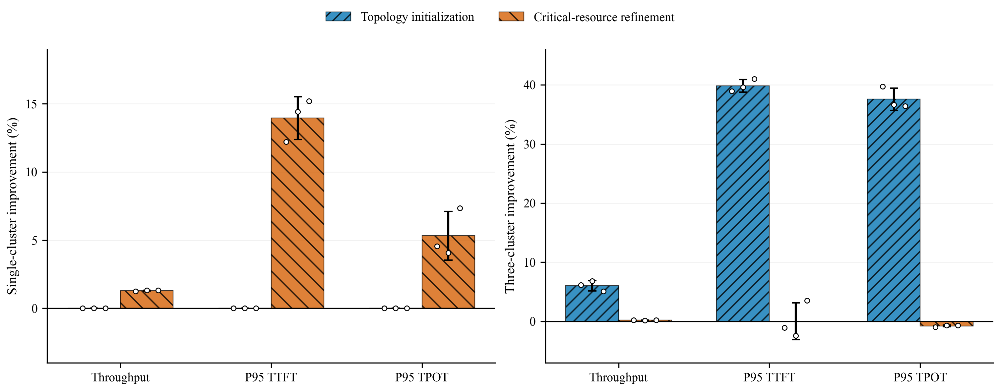

# 实验结果与归因（中文初稿）

## 完整系统效果

在 Helix 离散事件仿真器中，我们采用两种 24-GPU 异构拓扑、1800 秒固定窗口和官方请求强度，将 RCAPS 与 Helix 官方 ILP 放置及在线调度进行相同种子、相同请求轨迹的配对比较。表中数值为种子 0、1、2 的逐种子相对变化均值±样本标准差；吞吐为增加比例，P95 TTFT 和 P95 TPOT 为降低比例，正值表示改善。

| 拓扑 | 输出吞吐 | P95 TTFT | P95 TPOT | 到达强度 |
| --- | ---: | ---: | ---: | ---: |
| 单集群 | +8.67±0.39% | 34.28±1.32% | 54.22±1.29% | 700 token/s |
| 三集群 | +18.85±1.24% | 54.26±1.81% | 70.06±1.09% | 320 token/s |

六组指标均在 3/3 个种子中同向变化。固定窗口内，RCAPS 的平均完成率在单集群由 Helix 的 81.95% 提升至 91.82%，三集群由 70.21% 提升至 89.24%；对应窗口末平均积压由 231.7 降至 105.0、由 172.7 降至 62.3。重新运行并保存逐请求样本后，配对程序核对了同种子的轨迹哈希、请求 ID、输入／输出长度和到达时刻；个别到达时刻存在不超过约 1.2×10⁻¹³ 秒的浮点差异，按 10⁻⁹ 秒绝对容差判定相同。在两方法均观测到指标的共同请求集合上，三个种子的 TTFT 与 TPOT P95 改善方向仍与原固定窗口口径相同。这些检查降低了“不同轨迹或不同有效样本集合造成改善”的可能性，但未观察到输出的请求仍不进入 P95，截尾限制不能完全消除。

三个种子中，种子 1 曾用于开发调参。因此表格只描述所测拓扑和轨迹上的表现，不是独立盲测或真实 GPU 性能证明。即使某单项 3/3 同向，单侧精确符号检验的最小 p 值仍为 0.125；对六个场景／指标单元作 Holm 校正后为 0.75，不能称统计显著。

## 关键资源反馈的独立价值：三档放置阶梯

为区分显存容量构造、拓扑感知初始化和关键资源反馈，三档均使用相同的 RCAPS 在线调度器、24 台物理 GPU、双后缀结构、请求轨迹和 1800 秒官方负载窗口。A 仅按显存容量平衡布局；B 加入 RTT 分组和链路代价引导的顺序，但不做细化；C 从 B 出发，使用事件图关键资源反馈做局部移动。表中“增量”为三个种子的逐种子配对相对变化均值±样本标准差，正值表示改善。

| 拓扑 | 对照 | 吞吐增量 | P95 TTFT 降低 | P95 TPOT 降低 |
| --- | --- | ---: | ---: | ---: |
| 单集群 | B 容量＋拓扑 vs A 仅容量 | 0.00±0.00% | 0.00±0.00% | 0.00±0.00% |
| 单集群 | C 加关键资源细化 vs B | +1.30±0.03% | 13.96±1.56% | 5.32±1.78% |
| 三集群 | B 容量＋拓扑 vs A 仅容量 | +6.03±0.87% | 39.85±1.05% | 37.59±1.88% |
| 三集群 | C 加关键资源细化 vs B | +0.20±0.03% | 0.01±3.11% | **-0.77±0.14%** |

单集群 A 与 B 实际生成了相同的共享设备、支路顺序、层区间和合法链路配置，因此第一行是结构上的零差异，不能用来声称拓扑策略在单集群无用。三集群的 A 与 B 布局不同，B 相对 A 的完成率均值从 81.8% 升至 88.8%，窗口末积压均值从 105.3 降至 64.7；C 相对 B 的完成率从 88.8% 升至 89.2%，积压从 64.7 降至 62.3。共同可观测请求集合上的三集群 B/A P95 方向与全窗口统计一致。三集群 C/B 的 TPOT 在三个种子均略微变差，共同集合复算仍然同向；TTFT 一种子改善、两种子变差。因而在该拓扑和负载下，**拓扑感知初始化是主要的放置增益来源，关键资源细化的吞吐增量很小，不能称其全面改善尾延迟**。

单集群 C/B 在三个种子均改善三项指标，说明关键资源反馈的作用依赖拓扑和负载。开发负载中三集群细化改善约 3.09% TPOT，而官方负载中 TPOT 略微变差，进一步说明这一机制的效果不能跨负载泛化。上述结果是嵌套启发式的局部对照，不证明任何档位全局最优。完整系统相对 Helix 的收益不能与放置阶梯百分比直接相加；Helix 的放置和调度均不同。

## 固定正式放置的在线调度消融

在相同正式 RCAPS 放置和请求轨迹下，分别去掉路由代价中的当前 GPU／链路释放时间（`no_queue`）、活跃 KV 会话的一轮 decode 服务代价（`no_session`），或将同链路已就绪解码合并改为逐请求传输（`no_coalesce`）。表中正数表示**完整 RCAPS 相对该消融版本**改善；三种子均值±样本标准差，无法将各行百分比相加。

| 拓扑 | 移除的实现项 | 吞吐增量 | P95 TTFT 降低 | P95 TPOT 降低 |
| --- | --- | ---: | ---: | ---: |
| 单集群 | 当前释放时间 | +0.05±0.05% | 2.93±1.45% | 1.37±0.84% |
| 三集群 | 当前释放时间 | +0.05±0.06% | 5.23±6.27% | **-3.10±1.72%** |
| 单集群 | 活跃 KV 会话代价 | +0.40±0.10% | 1.65±0.56% | **-6.14±2.65%** |
| 三集群 | 活跃 KV 会话代价 | +3.45±0.76% | 4.62±6.43% | 31.48±1.51% |
| 单集群 | 就绪解码合并 | +1.48±0.03% | 6.01±0.92% | 17.75±0.26% |
| 三集群 | 就绪解码合并 | +2.11±0.33% | 2.63±5.28% | 16.42±1.40% |

结果显示，传输合并在两个拓扑的 TPOT 上给出较一致的增量；活跃会话代价在三集群的作用明显，但单集群 TPOT 反向；当前释放时间项对吞吐的增量很小，三集群 TPOT 也反向。因此“所有资源感知组件均改善所有指标”的说法不成立。每个消融仍在相同布局和完整物理拓扑中运行；共同请求集合、完成率和积压见 `THREE_SEED_COMPARISON.json`。

## 已有受控归因

已有开发负载（单集群 400、三集群 160 offered token/s；预热 180 秒、总窗口 1800 秒）的受控实验分别固定调度器或放置。固定早期 DAG 调度器时，切换到 RCAPS 放置在两种拓扑的三个种子上均改善了吞吐和两类 P95；但它仅说明这一特定调度器与负载下的放置作用。固定最终 RCAPS 放置时，切换到最终在线调度在单集群的平均吞吐、TTFT、TPOT 分别改善 1.78%、16.21%、38.11%；三集群分别为 0.41%、**-2.48%**、11.81%。负的 TTFT 值表示平均变慢，不能称调度组件在三集群全面改善延迟。

放置内部的局部细化在单集群开发负载带来 0.60% 吞吐增益，但在三集群的平均吞吐变化为 **-0.006%**、TTFT 为 **-0.36%**。这表明离线代理分数改善不保证每个在线指标改善。对比最终调度的逐请求串行传输版本，合并就绪解码传输在两种拓扑的 TPOT 平均降低约 11.22% 和 10.82%；但三集群的另一组“合并传输”内部对照显示 TPOT 平均变化为 **-1.02%**。这些控制实验对应不同代码阶段和对照组，不能合并为一个可加的组件贡献。新的统一版本消融结果将单独列出。

官方高负载下，“RCAPS 放置＋Helix 调度”在单集群种子 1 不可路由，故没有完整的三种子高负载放置归因。失败应作为约束和兼容性现象保留，不把中断前数值补成完整窗口结果。

## 负载与网络敏感性

沿用同一固定窗口协议，已有 0.7、1.0、1.1 倍官方负载扫描在两种拓扑的三个种子中均给出同向的完整系统变化。三集群将跨区域 RTT 缩放为 0.5、1、2 倍时，RCAPS 相对 Helix 的吞吐变化均值分别为 16.26%、18.85%、24.66%。三档重新规划得到相同的层划分，因此这些结果说明该已测放置对 RTT 改动的敏感性，不能证明层边界随 RTT 自适应。1.3 倍负载下 Helix 在三集群三个种子均中途不可路由，我们只记录失败边界，不计算该档的配对增益。

原始逐种子数值、配置和日志参见 `experiments/multiseed/RESULTS.md`、`experiments/ccfa_validation/RESULTS.md` 及其引用的 JSON。上述所有结论均限于事件仿真器和已测拓扑。
